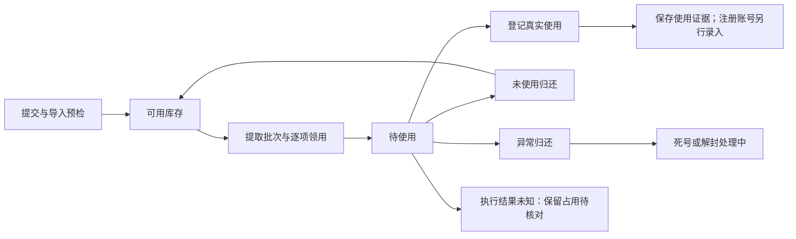
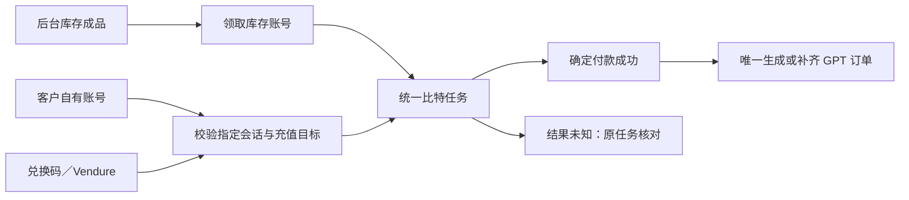

# ID 业务管理系统：业务闭环与开发蓝图

日期：2026-11-03。此文件记录本轮继续工作后的规划基准。原型用于设计审阅，不是正式业务系统；接口、数据库、生产迁移、外部注册、充值和付款均未在本轮执行。

最新订单与余额边界以 [ORDER_BOUNDARIES_REVISION.md](ORDER_BOUNDARIES_REVISION.md) 为准；本文件中现行规则已同步修订，历史验收不作为新规则通过证明。

## 1. 已确认规则

- 邮箱实际注册使用后退出通用可提取库存，不再拿去注册其他产品；已提取但未实际使用的邮箱允许归还。
- Vendure 与兑换码只给客户指定的自有账号充值或续费，不领取库存账号、不替换客户 Session。
- 邮箱、账号、订单独立管理。订单业务类型只有“续费／成品交付”，不再显示首次开通、账号来源或邮箱分类；客户续费可直接填写任意邮箱，成品交付才搜索选择对应产品的未使用账号。
- 同一 Claude 账号同一时段只服务一个客户。每次续费均新增独立订单；仅 Claude 专属快捷续费可带入当前资料并更新当前订阅，不要求通用订单关联原单。
- 租户、归属人、认证人分别记录。Claude 套餐为 Pro、Max 5x、Max 20x；GPT 为 Go、Plus、Pro5x、Pro20x、Pro50x。
- 普通订单以本次订阅时间建立新周期，只保留订阅时间与到期时间；不重复实际开通字段，不强制原到期起算确认。Claude 专属可从当前到期续接一个自然月，但仍新增订单。
- Claude 每单含续费按采用的费用配置快照核算：代付服务费默认 100 MYR、KYC 认证成本默认 50 MYR。苹果内购面额折扣默认 0.8，配置调整不改历史；订单不靠选择邮箱分类完成核算，也不按地址猜测成本。
- 普通银行卡开卡费用按每张卡一次 0.5 USD，付款按每笔 0.8% 加 0.3 USD。银行卡稳定 ID 是核算依据，尾六位仅用于显示和查找。
- 用户已明确：租金成本已经记录在成本里，付租页仅用于记录是否已发放。保留账号、对象、期间、发放状态、时间和备注，不要求租金金额或币种，不另计成本，也不因发放记录未完成阻断利润核算。
- 表格一条资料一行、一个字段一列；标签在左；页面、抽屉和分组说明使用标题右侧图标；切页保留侧栏位置及输入草稿。

## 2. 页面组织

保留原有分组，在工作台增加“提取与归还”，在系统设置补“操作记录”，按最新要求新增“线上代充”分组及两个占位页。其余补充能力优先采用已有页面的页签、详情页和抽屉。

| 区域           | 页面与详情                                                                                |
| -------------- | ----------------------------------------------------------------------------------------- |
| 工作台         | 提交订单、邮箱提交、邮箱提取、账号提取、提取与归还中心                                    |
| 提取与归还中心 | 我的待处理、提取历史、快捷归还、归还记录；点击批次进入逐项详情                            |
| 邮箱管理       | 谷歌、苹果隐藏邮箱；可用、已提取、已使用、死号、解封中视图；资料详情与导入记录            |
| 账号管理       | GPT、Claude 独立主档；成品账号可搜索选择；苹果 ID 余额、余额变动；Claude 养号与运营资料   |
| 客户资料       | 客户录入、客户列表、租户列表；详情、关联账号、订单及付租记录；快捷新增后回填              |
| 订单管理       | GPT、Claude Pro／Max 独立订单、待补全、详情、退款、更正；仅 Claude 提供快捷续费；数据统计 |
| Claude 专属    | 当前订阅、冻结／弃用、操作记录、续费；付租批次及逐项结果                                  |
| 比特充值       | 充值提交、任务与详情、兑换码、银行卡共享池、代理、姓名地址、设备连接                      |
| 线上代充       | ChatGPT 充值、Claude 充值占位；不自动接入执行能力                                         |
| 外部流程       | 客户兑换、会话提交、进度、成功／失败／待核对和原任务查询；不作为后台侧栏菜单              |
| 系统设置       | 员工与角色、邮箱分类、费用与汇率规则、审计记录                                            |
| 工具箱         | 十个个人工具及管理、六项在线工具的输入与结果设计、话术搜索／分页／管理／复制              |

总览、微软邮箱、Gemini 账号、Grok 账号、Gemini 订单、Grok 订单、数据中心、监控中心八个原占位，加上两个线上代充占位，共十个占位。当前目标为 39 个后台菜单落点，其中 29 个业务设计页、10 个占位；详情与外部兑换流程不计入菜单数量。页面具备原型不等于已经接入真实业务。

## 3. 库存与领用闭环

### 资料、占用、使用分开

1. 主档保存稳定资料 ID、类型和健康状态。不同状态视图不搬库、不复制全行。
2. 提取批次保存操作者、用途、备注、时间、请求标识和逐项明细。多次提取不能覆盖之前的批次。
3. 提取明细保存当次占用、使用或归还结果。资料创建人、领用人和业务归属人不能混为一人。
4. 保存实际使用证据；手工注册后可独立录入账号，来源引用仅作可选追溯，不强制邮箱与账号外键。不能仅因复制了密码就认定已经使用。
5. 归还记录保存原提取明细、原因、去向、时间和操作人。归还只解除合法领用，不恢复整行历史快照。

### 处理规则

- 同一份可用资料同一时刻只允许一个有效领用；数量不足明确拒绝，不静默少领。
- 已注册、已充值、已交付、显式关联有效交付或任务、付款未知的资料禁止按“未使用”归还；仅在客户订单中出现相同邮箱，不建立库存引用或阻止独立资料操作。
- 批量归还先预览可归还项与阻止原因，确认后逐项事务处理，提供成功／失败回执；重试仅处理失败项。
- 死号和解封中恢复时重新检查真实使用和业务关联，不自动解除历史占用。
- “我的待处理”默认查看当前员工的有效领用；跨员工处理需要独立权限与审计，查看库存权限不自动授予该能力。
- 邮箱地址不能完全确定资产类型；Apple ID 可能用 Gmail 地址。注册时间与系统入库时间分别保存。
- 导入批次和逐行结果可查询；错误修正与重试不得重复写入已成功行。

原型只在当前页面内存演示。它可以保留多个批次、切页和详情关联，并以昨日批次展示历史操作，但不代替正式数据库的跨天、重新登录和并发验收。

## 4. 订单、订阅与付租闭环

- 客户／租户主档保存当前资料，订单保存交易时快照；同名不能自动合并。
- 订单资料完整性、实际收付款、退款、订阅到期和账号运营状态分别表达。
- 客户续费直接创建新订单，无须系统中存在旧单或库存。只有 Claude 专属快捷续费按当前订阅续接到期，并保留可选操作来源和全部独立订单。
- 订单详情保存客户及邮箱快照、成本汇率、退款、更正及操作记录。成品交付可保存明确选择的库存编号，自动任务保留来源证据；通用订单不依赖账号或邮箱主档。
- 退款记录原币种、实际金额和累计值，不超过原实收；本轮只登记设计，不调用支付退款接口。
- 已有真实支出的冻结或弃用，不自动冲回付款；修改撤回不能抹掉付款和后续记录。
- 付租批次按账号、租户和期间逐项登记是否发放，允许十条只发八条，保留其余待发／失败事项。不填写租金金额，不产生财务支出或重复扣成本。
- 缺收款、成本、汇率或付款证据的订单进入待核算，不按零成本显示最终利润。租金发放记录与订单核算独立。
- 标准费用和实际支出分别展示；费用配置版本变化只影响后续订单，历史按已采用快照展示。

苹果 ID 余额移至账号管理。确认内购支出后按所选 ID 的美元余额记录扣款，重复提交不重复扣；客户退款、Apple 余额退回和更正补偿分开。Apple 返还口径仍待用户最终答复，详见最新修订；不通过撤单静默回增余额。

## 5. 充值对象与执行闭环

统一的是任务执行、付款核对和订单生成能力，充值目标仍按入口保持。外部提供的客户账号不进入可售库存；订单表单只保留续费／成品交付，不再增加首次开通或账号来源选择。

- 兑换码为四组四位数字，实际系统需安全随机、唯一约束、次数限制和一次性核销。
- 兑换页需显示明确套餐及有效性；提交后保留查询凭据和原任务编号。
- 超时先查询原受理结果，不重复核销、付款或换一个库存账号重试。
- 付款未知保留账号和资源占用；执行租约到期不代表真实付款没有发生。
- 成功任务依据稳定任务／付款证据唯一关联订单。补充资料更新原待补全订单。
- 银行卡、代理、姓名地址和连接器复用现有资源；导航移动不改变资源编号、占用和历史。
- 原接口适配先保留，待接入验收后再退役旧路径；不先删除包含仍在使用能力的旧目录。

## 6. 模块与接口责任

正式实现继续采用 Vue 3／Element Plus、NestJS、Prisma／MySQL 和现有 V2 模块登记。

| 模块              | 负责的事实与公开能力                                                             |
| ----------------- | -------------------------------------------------------------------------------- |
| 邮箱／账号库存    | 各自独立的主档、状态与领用；账号提供成品交付的可用查询和确认使用，不强制邮箱关系 |
| 提取归还          | 批次、逐项领用、使用登记、归还及回执，不复制资产主档                             |
| 客户租户          | 当前主档、业务人员及关联资料，提供搜索和快捷新增                                 |
| 订阅订单          | 独立交易事实、订单邮箱、快照、退款和更正；仅 Claude 快捷续费可带当前订阅上下文   |
| 苹果 ID 余额      | ID 余额、确认扣款、实际返还和更正补偿流水；提供预检及幂等记账能力                |
| Claude 运营／付租 | 当前订阅查询、运营历史、租金发放对象／账号／期间／状态记录                       |
| 比特任务          | 请求来源、指定充值目标、资源占用、执行状态和付款证据                             |
| 统计配置          | 费用版本、汇率快照和可钻取统计，不另维护可随意修改的利润字段                     |
| 系统基础与工具    | 身份、权限、审计、草稿、加载、个人网址、话术及已有在线工具                       |

跨域写入由应用命令层编排，复用现有事务与幂等机制；库存和订单不能互相读取内部 repository。组合页面通过聚合查询获取关联资料，避免循环依赖。

原型的 `IDDesignAPI` 和独立脚本只负责本目录的演示组合，不作为正式系统的新框架、身份或 API。

## 7. 交互与验收

每个非占位页面都需设计正常、首次加载、保留内容刷新、首次失败、刷新失败、空数据和无权限状态；原型通过“状态预览”检查，正式系统由共享查询层驱动。

必须覆盖：

1. 十个邮箱使用七个、归还三个；原批次和七个使用来源保持，重复归还不增加库存。
2. 第二次提取后第一批仍可查询；批次详情、库存详情及归还记录互相定位。
3. 两人领同一资料、归还他人资料、提交后状态变化等冲突可明确解释。
4. 客户快捷新增后自动选中；账号、客户、订单和租户记录不因编辑名称断链。
5. 无历史、无库存的邮箱可以创建独立续费单；成品交付只使用选定库存一次；Claude 快捷续费新建订单并更新专属到期。部分退款累计受限，同一 Claude 订阅不同时服务另一客户。
6. 租金发放批次部分完成可继续处理，不要求金额和币种，登记发放不改变订单成本。
7. 兑换码重复请求、受理超时、付款未知、重复回调不会重复执行或生成订单。
8. Apple ID 余额 250→230 的确认扣款、幂等、余额不足、实际返还和补偿撤回可逐条核对；客户退款不自动等于余额返还。筛选、分页、草稿、主题和窄屏遵守共享规范。
9. 侧栏切页保留位置；标题说明点击、键盘和移动触控可用；操作列始终可见。
10. 顶栏显示唯一的当前页标题与说明图标，内容区移除独立标题行；操作归入对应列表、页签或表单区域。表单按容器使用三／二／一列，短字段并排，长内容跨列；不靠缩小点击区域减少滚动。

原型可证明页面和演示操作；正式数据持久化、事务、并发、权限和外部结果必须另行验证。本轮不 commit、push、创建 PR 或部署。
